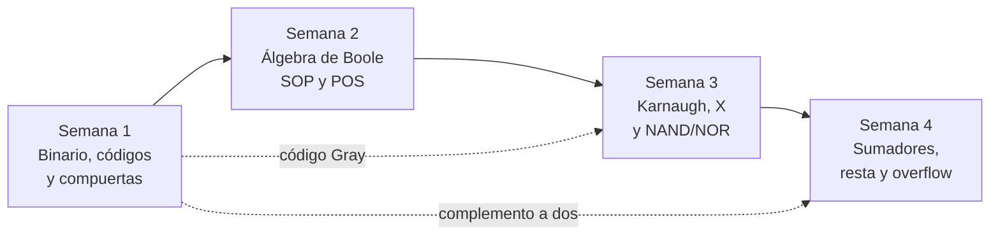

# 📘 Libro Digital 
## Diseño de Circuitos

### Unidad 1 · Lógica combinacional con diseño clásico

## 👤 Datos generales

| | |
|---|---|
| 👩‍💻 **Estudiante** | Josselyn Tatiana Cale Cale |
| 👨‍🏫 **Docente** | Ing. Luis Darío Sinche Cueva |
| 🏫 **Universidad** | Universidad Nacional de Loja · Carrera de Computación |
| 📚 **Materia** | Diseño de Circuitos · 2.º ciclo |
| 🗓️ **Período** | Septiembre 2026 – marzo 2027 |
| 🎯 **Unidad 1** | Análisis de lógica combinacional con diseño clásico |

---

## 🎯 Presentación

Este informe reúne un resumen de cada semana de clases de la Unidad 1. Cada semana tiene su propio documento con los conceptos clave, ejemplos resueltos y ejercicios. El recorrido va de los **sistemas numéricos y las compuertas** hasta construir un **sumador de 4 bits**.

## 🗂️ Índice

| Semana | Tema | Documento |
|:---:|---|---|
| 1 | Sistemas numéricos, códigos y compuertas lógicas | [Ver resumen](semanas/semana-01.md) |
| 2 | Álgebra de Boole y formas canónicas | [Ver resumen](semanas/semana-02.md) |
| 3 | Mapas de Karnaugh, condiciones indiferentes y NAND/NOR | [Ver resumen](semanas/semana-03.md) |
| 4 | Circuitos aritméticos: sumador, resta, overflow y comparador | [Ver resumen](semanas/semana-04.md) |

## 🧭 Hilo conductor del curso

1. **Semana 1:** el computador usa 0 y 1, y las compuertas son sus piezas básicas.
2. **Semana 2:** una compuerta es una expresión, y con álgebra se obtiene la tabla de verdad y la forma canónica.
3. **Semana 3:** los mapas de Karnaugh simplifican de forma visual y NAND/NOR permiten construir todo con una sola familia.
4. **Semana 4:** con lo anterior se diseña un sumador, base de la ALU de un procesador.

## 🛠️ Herramientas utilizadas en el curso

- **Logisim-evolution:** simulador de circuitos lógicos.
- **Circuitos integrados TTL 74LS:** 7400 (NAND), 7404 (NOT), 7408 (AND), 7410 (NAND de 3 entradas), 7411 (AND de 3 entradas), 7432 (OR), 7483 (sumador de 4 bits), 7485 (comparador).
- **Basys 3:** tarjeta FPGA para el proyecto integrador (Unidades 2 y 3).

## 📚 Bibliografía del curso

- Carpinelli, J. D. (2023). Texto base de la asignatura (apartados de álgebra de Boole, mapas de Karnaugh e indiferentes).
- Garza, J. Á. (2025). *Electrónica digital I: álgebra de Boole, De Morgan y formas canónicas.*
- Material de clase del Ing. Luis Darío Sinche Cueva, Mg. (presentaciones de las semanas 1 a 4).

---

*Elaborado por Josselyn Tatiana Cale Cale · Diseño de Circuitos · UNL*

