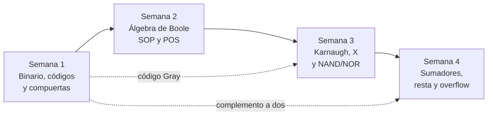

  

# 📘 Libro digital · Diseño de Circuitos

> Resúmenes con mis propias palabras de las primeras semanas de la materia, con diagramas para entender mejor cada tema.

| | |
|---|---|
| 👩‍💻 **Estudiante** | Josselyn Tatiana Cale Cale |
| 👨‍🏫 **Docente** | Ing. Luis Darío Sinche Cueva |
| 🏫 **Universidad** | Universidad Nacional de Loja · Carrera de Computación |
| 📚 **Materia** | Diseño de Circuitos · 2.º ciclo |
| 🗓️ **Período** | Septiembre 2026 – marzo 2027 |
| 🎯 **Unidad 1** | Análisis de lógica combinacional con diseño clásico |

---

## 🗂️ Índice

| Semana | Tema | Lo más importante |
|:---:|---|---|
| **[1](semana-01/README.md)** | Sistemas numéricos, códigos y compuertas lógicas | Binario, hexadecimal, complemento a dos, BCD, Gray, ASCII y las 7 compuertas |
| **[2](semana-02/README.md)** | Álgebra de Boole y formas canónicas | Postulados, De Morgan, minitérminos, SOP y POS, simplificación |
| **[3](semana-03/README.md)** | Mapas de Karnaugh, indiferentes y NAND/NOR | Agrupar unos, condiciones indiferentes, circuitos con una sola familia de compuertas |
| **[4](semana-04/README.md)** | Circuitos aritméticos | Semisumador, sumador completo, sumador de 4 bits, resta, overflow y comparador |

---

## 🧭 Cómo está organizado este libro

Cada semana tiene su propia carpeta con un `README.md`. En cada una encontrarás:

1. 🎯 **Qué se buscaba aprender** esa semana.
2. 📖 **El resumen** explicado con mis palabras, paso a paso.
3. 🖼️ **Imágenes y diagramas** que hice para entender mejor.
4. ✍️ **Ejemplos resueltos** y ejercicios de práctica.
5. ✅ **Lo que me llevo**: las ideas clave en pocas líneas.

> [!TIP]
> Si algo no se entiende, sigan el orden de las semanas: cada tema se apoya en el anterior. Por ejemplo, el código Gray de la semana 1 es justo el orden de los mapas de Karnaugh de la semana 3, y el complemento a dos de la semana 1 es lo que permite restar en la semana 4.

---

## 🔗 Cómo se conectan los temas

---

## 📝 Glosario rápido

| Término | Qué significa para mí |
|---|---|
| **Bit** | Un dígito binario: 0 o 1. 8 bits = 1 byte |
| **Compuerta lógica** | Un circuito pequeño que toma entradas de 0/1 y entrega una salida de 0/1 |
| **Tabla de verdad** | Lista de todas las combinaciones de entrada y la salida que debe dar el circuito |
| **Minitérmino (mᵢ)** | Producto que vale 1 solo en una fila de la tabla |
| **Maxitérmino (Mᵢ)** | Suma que vale 0 solo en una fila de la tabla |
| **SOP** | Suma de productos (se leen los 1 de la tabla) |
| **POS** | Producto de sumas (se leen los 0 de la tabla) |
| **Implicante primo** | Un grupo del mapa de Karnaugh que ya no se puede agrandar |
| **Indiferente (X)** | Combinación que nunca ocurre; se usa como 0 o 1, lo que más convenga |
| **Acarreo (carry)** | El «me llevo» de una suma |
| **Overflow** | Cuando el resultado de una suma con signo no cabe en los bits disponibles |
| **CI** | Circuito integrado (el chip) |

---

  Hecho con 💙 por <b>Josselyn Tatiana Cale Cale</b> · Diseño de Circuitos · UNL

